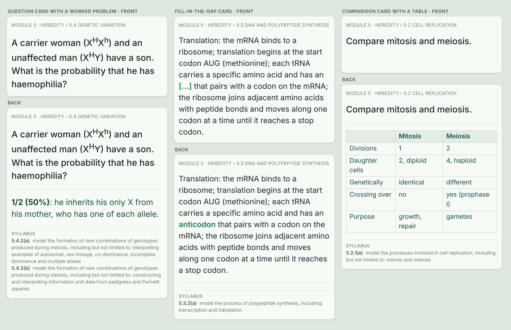

# NSW HSC Biology (Biology Stage 6 Syllabus, 2017)

**886 notes (991 cards) · 31 decks · 2 note types · for Anki 2.1.50+ / AnkiDroid / AnkiMobile**

> **Which syllabus?** This deck follows the **Biology Stage 6 Syllabus (2017)**:
> Modules 1–8. That syllabus is examined up to and including the **2027 HSC**.
> NESA's new *Biology 11–12 Syllabus (2025)* starts in Year 11 in 2027 (first
> HSC exam 2028) and is organised differently; this deck does **not** cover it.

Every Year 11 and Year 12 content dot point of the syllabus has at least one
card, in a sub-deck for its **inquiry question**, plus two skills decks: the
**NESA key words** (with NESA's own definitions) and **Working Scientifically**.
Every card shows the syllabus dot point it covers.



---

## Contents

| Deck | Inquiry question | Cards |
|---|---|---:|
| **Module 1 · Cells as the Basis of Life** (Year 11) | | **82** |
| 1.1 Cell Structure | What distinguishes one cell from another? | 36 |
| 1.2 Cell Function | How do cells coordinate activities within their internal environment and the external environment? | 46 |
| **Module 2 · Organisation of Living Things** (Year 11) | | **93** |
| 2.1 Organisation of Cells | How are cells arranged in a multicellular organism? | 17 |
| 2.2 Nutrient and Gas Requirements | What is the difference in nutrient and gas requirements between autotrophs and heterotrophs? | 49 |
| 2.3 Transport | How does the composition of the transport medium change as it moves around an organism? | 27 |
| **Module 3 · Biological Diversity** (Year 11) | | **76** |
| 3.1 Effects of the Environment on Organisms | How do environmental pressures promote a change in species diversity and abundance? | 12 |
| 3.2 Adaptations | How do adaptations increase the organism's ability to survive? | 17 |
| 3.3 Theory of Evolution by Natural Selection | What is the relationship between evolution and biodiversity? | 26 |
| 3.4 Evolution – the Evidence | What is the evidence that supports the Theory of Evolution by Natural Selection? | 21 |
| **Module 4 · Ecosystem Dynamics** (Year 11) | | **71** |
| 4.1 Population Dynamics | What effect can one species have on the other species in a community? | 30 |
| 4.2 Past Ecosystems | How do selection pressures within an ecosystem influence evolutionary change? | 24 |
| 4.3 Future Ecosystems | How can human activity impact on an ecosystem? | 17 |
| **Module 5 · Heredity** (Year 12) | | **149** |
| 5.1 Reproduction | How does reproduction ensure the continuity of a species? | 31 |
| 5.2 Cell Replication | How important is it for genetic material to be replicated exactly? | 27 |
| 5.3 DNA and Polypeptide Synthesis | Why is polypeptide synthesis important? | 34 |
| 5.4 Genetic Variation | How can the genetic similarities and differences within and between species be compared? | 39 |
| 5.5 Inheritance Patterns in a Population | Can population genetic patterns be predicted with any accuracy? | 18 |
| **Module 6 · Genetic Change** (Year 12) | | **78** |
| 6.1 Mutation | How does mutation introduce new alleles into a population? | 34 |
| 6.2 Biotechnology | How do genetic techniques affect Earth's biodiversity? | 14 |
| 6.3 Genetic Technologies | Does artificial manipulation of DNA have the potential to change populations forever? | 30 |
| **Module 7 · Infectious Disease** (Year 12) | | **123** |
| 7.1 Causes of Infectious Disease | How are diseases transmitted? | 40 |
| 7.2 Responses to Pathogens | How does a plant or animal respond to infection? | 17 |
| 7.3 Immunity | How does the human immune system respond to exposure to a pathogen? | 21 |
| 7.4 Prevention, Treatment and Control | How can the spread of infectious diseases be controlled? | 45 |
| **Module 8 · Non-infectious Disease and Disorders** (Year 12) | | **114** |
| 8.1 Homeostasis | How is an organism's internal environment maintained in response to a changing external environment? | 31 |
| 8.2 Causes and Effects | Do non-infectious diseases cause more deaths than infectious diseases? | 25 |
| 8.3 Epidemiology | Why are epidemiological studies used? | 19 |
| 8.4 Prevention | How can non-infectious diseases be prevented? | 9 |
| 8.5 Technologies and Disorders | How can technologies be used to assist people who experience disorders? | 30 |
| **Skills · Key words (NESA glossary)** | all 37 key words, plus what each demands in a Biology answer | **49** |
| **Skills · Working Scientifically** | the seven skill areas, the syllabus glossary terms, data and graphing | **51** |

The HSC exam tests Year 12 content (Modules 5–8) and Working Scientifically
skills, with Year 11 content as assumed knowledge.

Searchable tags: about 110 cards use **Australian examples** (`tag:bio::aus`),
52 cover the **history of science** (`tag:bio::history`), 87 are
**comparisons** (`tag:bio::compare`), 30 are **worked problems** (`tag:bio::calc`),
and 16 deal with **Aboriginal and Torres Strait Islander** knowledge and
perspectives (`tag:bio::indigenous`).

## Installation

1. Download **[`dist/Biology_NSW_HSC_2017_syllabus.apkg`](dist/Biology_NSW_HSC_2017_syllabus.apkg)** (everything),
   or a single module from [`dist/decks/`](dist/decks/).
2. In Anki: *File → Import* (or double-click the file).

The combined and per-module packages use the same note IDs, so you can mix
them or re-import an updated version: your review history is kept and the
notes are updated, not duplicated.

## How to study it

**Recommended settings** (deck options for *Biology (NSW HSC · 2017 syllabus)*):

| Setting | Value | Why |
|---|---|---|
| New cards/day | 10–15 | the whole deck in about 2–3 months; Module 5–8 alone in about 5–7 weeks |
| New card gather order | **Deck** | new cards arrive module by module, in syllabus order |
| Review order | default | reviews from every unlocked deck are mixed |
| FSRS | on, desired retention 0.90 | (Anki 23.10+) fewer, better-timed reviews |
| Leech threshold | 8, action *Tag only* | leeches show which idea hasn't clicked yet |

- **In Year 12, preparing for the HSC**: start with Modules 5–8 and the key
  words deck (suspend or delay Modules 1–4, or click *Study* on one module deck
  at a time), then add Year 11 modules for revision.
- **During the school year**: study the deck for the module you're being
  taught, so cards reinforce lessons.
- Study from a **parent** deck when you can: new cards come in order, while
  reviews are interleaved across topics.

**How to answer a card**

1. Answer **out loud or in writing** before you flip, in full sentences for
   "explain" and "compare" cards. Producing the answer is the practice.
2. Flip. Grade **Good** only if you had the key idea **and** the right
   terminology. Right but vague or slow → **Hard**. Missed the main point → **Again**.
3. Read the explanation and exam tip, and glance at the **syllabus dot point**
   at the bottom: over time you'll learn where every fact sits in the syllabus.

Fill-in-the-gap (cloze) cards turn ordered processes (mitosis, DNA
replication, transcription, the path of blood or sound) into several cards,
one gap at a time.

## Pedagogy: why the cards look like this

- **Retrieval, not re-reading.** Recalling an answer strengthens memory far
  more than reading notes (Roediger & Karpicke, 2006); producing it beats
  recognising it (Slamecka & Graf, 1978).
- **One idea per card.** Answers are kept short (the checker warns above 45
  words); detail goes into the explanation underneath (Wozniak, 1999).
  Long processes are split into cloze cards instead of one huge card.
- **Why and how, not only what.** Many cards ask for **cause-and-effect**
  ("why do muscle cells have many mitochondria?"), which is what HSC "explain"
  questions reward, and explaining is itself a strong learning strategy
  (elaborative interrogation; Dunlosky et al., 2013).
- **Comparisons and worked problems.** Commonly confused pairs (mitosis and
  meiosis, codominance and incomplete dominance, incidence and prevalence,
  validity and reliability) get comparison cards; genetics, SA:V, magnification,
  population sampling and disease rates get worked problems.
- **The syllabus is visible.** Each card names its dot point, and the decks
  follow the inquiry questions, so studying the deck also teaches the shape
  of the course.
- **Australian context.** The syllabus asks for Australian examples (cane
  toads, prickly pear, Australian megafauna and sclerophyll plants, myrtle
  rust, smoke bush, cochlear implants); the deck uses them wherever it can.
- **Interleaving.** Reviews from every unlocked deck are mixed, which improves
  long-term retention and the ability to tell similar ideas apart (Rohrer &
  Taylor, 2007).

## How accuracy is checked

```bash
pip install -r requirements.txt                       # from the repository root
python biology/nsw-hsc-2017/tools/test_verify.py      # 1. prove the checker catches mistakes
python biology/nsw-hsc-2017/tools/verify.py           # 2. check every card → VERIFICATION.md
python biology/nsw-hsc-2017/tools/build.py            # 3. build dist/*.apkg
```

1. **Syllabus map and coverage.** [`syllabus.yaml`](syllabus.yaml) lists every
   inquiry question and content dot point of the official syllabus document,
   plus the Working Scientifically skills and the syllabus glossary, and
   [`keywords.yaml`](keywords.yaml) lists NESA's glossary of key words. Both
   were transcribed from NESA's published documents and checked against them
   word for word. Every card cites at least one dot point; `verify.py` **fails
   if any "including" dot point has no card**, and warns about uncovered
   "for example" points. Current status: **252 of 252** dot points, skills and
   key words covered.
2. **Official definitions, verbatim.** Cards that give a syllabus-glossary
   definition (validity, reliability, hypothesis, niche…) or a NESA key word
   must match NESA's wording exactly.
3. **Worked problems recomputed.** Each problem card declares its inputs and
   result (e.g. `p1: XH/Xh, p2: XH/Y, given: male → 1/2`). [`tools/biocalc.py`](tools/biocalc.py)
   recomputes it independently (Punnett-square crosses including sex-linked,
   codominant, incomplete-dominance and ABO crosses, complementary strands,
   transcription, translation with the standard codon table, SA:V,
   magnification, quadrat and capture–recapture estimates, half-lives, rates
   per 100 000, allele frequencies, Chargaff's rules), and the card fails if the
   declared result or the answer text disagrees.
4. **Structure.** Unique IDs, well-formed cloze deletions, known fields and
   tags, cited dot points that exist and belong to the card's deck, short
   answers, balanced formatting, and chemistry written with proper subscripts.
5. **Spelling, in Australian English.** Every word is checked against an English
   dictionary, accepting Australian spellings of dictionary words
   (colour, haemoglobin, specialise…) and a reviewed list of biology terms and
   names ([`tools/spelling_allowlist.txt`](tools/spelling_allowlist.txt)).
   **US spellings are errors** (color, hemoglobin, estrogen, -ize…).
6. **Duplicates.** Identical questions fail; near-identical ones are flagged.
7. **Human review list.** What a machine can't judge is listed in
   [`VERIFICATION.md`](VERIFICATION.md): every card containing numbers or dates,
   history of science, sources, Aboriginal and Torres Strait Islander content,
   and 57 cards the author flagged as worth double-checking (e.g. figures that
   change over time, such as extinction counts or recent outbreaks). When a
   qualified reviewer (e.g. a Biology teacher) has checked a card, add its id to
   [`reviewed.yaml`](reviewed.yaml) and it's ticked off in the report.

The self-test (`test_verify.py`) feeds the checker deliberately wrong cards
(a wrong mRNA, a 3:1 ratio for a test cross, a 1/4 chance for a carrier
mother's son, "hemoglobin", a paraphrased glossary definition, a cloze with a
missing number…) and fails if any gets through.

**Current status:** 0 errors, 0 warnings (see [`VERIFICATION.md`](VERIFICATION.md)).
The human-review checklist (242 cards) **has not yet been signed off** by a
Biology teacher. Treat the flagged facts with appropriate caution until it is.

**A note on Aboriginal and Torres Strait Islander content.** The syllabus asks
students to learn about Aboriginal rock art as evidence, caring for Country,
bush medicine, Aboriginal protocols and Indigenous cultural and intellectual
property. The cards summarise widely published material at an introductory
level; they're tagged `bio::indigenous`, listed for review, and are best
discussed alongside local community perspectives and the resources your school
uses.

## Note types

**Biology Q&A (nsw-hsc-2017)**, one card per note:

| Field | Content |
|---|---|
| `ID` | stable id, `deck-card` (e.g. `5.4-015`) |
| `Question`, `Answer` | the card itself |
| `Hint` | optional hint, shown on demand on the front |
| `Explanation` | detail, examples and context, shown on the back |
| `Tip` | exam tip, where useful |
| `Source` | attribution, where needed |
| `Syllabus`, `Ref` | the dot point(s) the card covers, with their codes (e.g. `5.4.2(a)`) |
| `Location` | breadcrumb: module and inquiry question |

**Biology cloze (nsw-hsc-2017)** has the same fields, with `Text` (cloze
deletions) instead of `Question`/`Answer`.

**Tags:** `bio::m5::iq5.4` (module and inquiry question), `bio::year11` or
`bio::year12`, `bio::dp::5.4.2a` (every cited dot point), `bio::skills::kw` or
`bio::skills::ws`, and `bio::aus`, `bio::history`, `bio::indigenous`,
`bio::ethics`, `bio::data`, `bio::practical`, `bio::compare`, `bio::calc`,
`bio::cloze`. For example, `tag:bio::dp::7.4.2c` shows every card on
vaccination, and `tag:bio::calc` gathers every worked problem.

## Editing and contributing

The cards live in [`src/`](src/), one YAML file per deck:

```yaml
deck:
  module: 5
  iq: 4                       # title and inquiry question come from syllabus.yaml
cards:
  - id: 15                    # never renumber: it seeds the note's GUID
    q: "A carrier woman (X^H^X^h^) and an unaffected man (X^H^Y) have a son. What is the probability that he has haemophilia?"
    a: "**1/2 (50%)**: he inherits his only X from his mother, who has one of each allele."
    x: "Optional explanation."
    tip: "Optional exam tip."
    dp: [5.4.2a, 5.4.2b]      # first one must belong to this deck
    calc: {kind: cross, p1: "XH/Xh", p2: "XH/Y", ask: probability, of: h, given: male, result: "1/2"}
  - id: 16
    cloze: "Mitosis: {{c1::prophase}} → {{c2::metaphase}} → …"
    dp: [5.2.1a]
```

Other optional keys: `hint`, `source`, `tags`, `glossary:` / `keyword:` (the
answer must then be the official definition) and `review:` (a note for the
human reviewer). Formatting: `**bold**`, `*italic*`, `X^H^` (superscript),
`- ` lists, `1. ` numbered lists and `| a | b |` tables. The full format is
documented in [`tools/deckdata.py`](tools/deckdata.py) and the calculators in
[`tools/biocalc.py`](tools/biocalc.py).

```bash
python biology/nsw-hsc-2017/tools/verify.py --strict   # must report 0 errors, 0 warnings
python biology/nsw-hsc-2017/tools/build.py             # rebuilds dist/*.apkg
```

Found a mistake? Open an issue or a pull request with the card's ID (shown in
the `ID` field and at the start of every line of `VERIFICATION.md`).

## Credits and sources

- Syllabus content, inquiry questions, syllabus glossary and the Glossary of
  key words: **NSW Education Standards Authority (NESA)**,
  [Biology Stage 6 Syllabus (2017)](https://www.nsw.gov.au/education-and-training/nesa/curriculum/science/biology-stage-6-2017)
  and [Glossary of key words](https://www.nsw.gov.au/education-and-training/nesa/hsc/student-guide/glossary),
  © NESA, reproduced for non-commercial educational use. This deck is not
  produced or endorsed by NESA.
- Package building: [genanki](https://github.com/kerrickstaley/genanki).
  Spelling: [pyspellchecker](https://github.com/barrust/pyspellchecker).
- Research mentioned above: Roediger & Karpicke (2006), *Psychological Science*
  17(3); Slamecka & Graf (1978), *JEP: Human Learning and Memory* 4(6);
  Dunlosky et al. (2013), *Psychological Science in the Public Interest* 14(1);
  Rohrer & Taylor (2007), *Instructional Science* 35; Wozniak (1999), *SuperMemo*.
