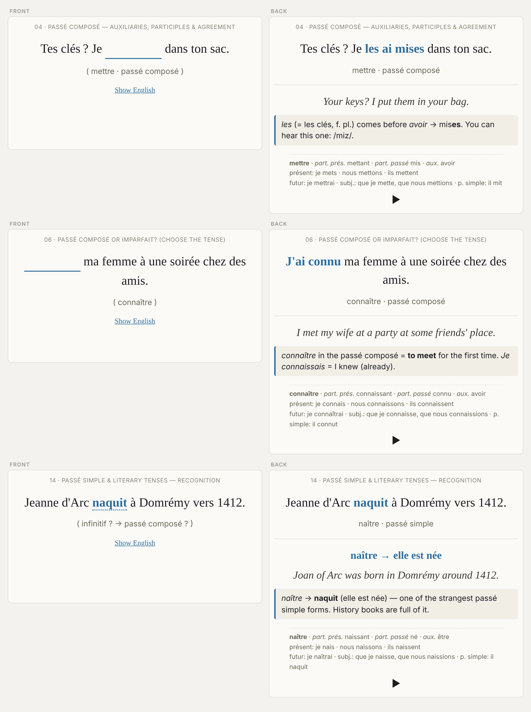

# French Verbs in Context (B1–B2)

**488 cards · 14 sub-decks · 1 note type · for Anki 2.1.50+ / AnkiDroid / AnkiMobile**

An intermediate deck for the part of French that never quite sticks: irregular
forms, auxiliaries and agreement, and above all **choosing the right tense**.
Every card is a real sentence with one verb missing. Many are quotations,
proverbs and fixed expressions, so you pick up the cultural background along
the way.



---

## Contents

| # | Sub-deck | Mode | Cards | What it drills |
|---|---|---|---:|---|
| 01 | Présent I — spelling & stem changes | form | 23 | ç/ge, è/ll/tt, y→i, -iss-, partir/ouvrir patterns, *depuis* + présent |
| 02 | Présent II — irregular verbs | form | 41 | the everyday irregulars and their families (venir/tenir, prendre, -indre, -uire, -aître…) |
| 03 | Impératif | form | 33 | sois/aie/sache/veuillez, va / vas-y, pronoun order, reflexives |
| 04 | Passé composé | form | 50 | être vs avoir, verbs that switch, irregular participles, every agreement rule |
| 05 | Imparfait & plus-que-parfait | form | 36 | stems, spelling traps (étudiions, payiez), uses |
| 06 | Passé composé or imparfait? | **choice** | 38 | event vs background, meaning changes (connaître, savoir, devoir, pouvoir) |
| 07 | Futur simple & futur antérieur | form | 36 | irregular stems, *quand / dès que* + futur, futur of probability |
| 08 | Conditionnel présent & passé | form | 34 | politeness, advice, regrets, future-in-the-past, journalistic conditional |
| 09 | « Si » clauses | **choice** | 29 | the three patterns, mixed hypotheses, *comme si*, *au cas où*, *si* = whether |
| 10 | Subjonctif présent & passé | form | 38 | two-stem formation, the ten irregulars, fixed phrases (*Vive…!*, *Ainsi soit-il*) |
| 11 | Subjunctive or indicative? | **choice** | 40 | minimal pairs: espérer/souhaiter, probable/possible, après que/avant que… |
| 12 | Reported speech | **choice** | 28 | sequence of tenses, *demain → le lendemain*, indirect questions |
| 13 | Gérondif, participles & past infinitive | form | 28 | en + -ant, étant/ayant/sachant, après avoir/être…, fatigant vs fatiguant |
| 14 | Passé simple & literary tenses | **recognise** | 34 | read and identify passé simple, passé antérieur, imperfect subjunctive |

About 1 card in 7 (69 cards) is a **quotation, proverb or fixed expression**,
with its source: Hugo, La Fontaine, Molière, Racine, Proust, Camus, Beauvoir,
de Gaulle, *chanson* (Aznavour, Brel, Dassin, Prévert), the *Marseillaise*,
the *Déclaration des droits de l'homme*… Search `tag:fr::quote` or
`tag:fr::proverb` to study them on their own.

## Installation

1. Download **[`dist/French_Verbs_B1-B2.apkg`](dist/French_Verbs_B1-B2.apkg)** (all 14 sub-decks).
   If you'd rather add one deck at a time, download individual decks from
   [`dist/decks/`](dist/decks/).
2. In Anki: *File → Import* (or just double-click the file).

The combined package and the single-deck packages use the same note IDs, so
you can mix them, or re-import an updated version: your review history is kept
and the notes are updated, not duplicated.

## How to study it

**Recommended settings** (deck options for *French::Verbs (B1–B2)*):

| Setting | Value | Why |
|---|---|---|
| New cards/day | 8–12 | ≈ 6–8 weeks for the whole deck, ~30–40 reviews a day at steady state |
| New card gather order | **Deck** | new cards then arrive in the intended order, 01 → 14 |
| Review order | default (due date, random) | reviews from all unlocked sub-decks get **mixed** |
| FSRS | on, desired retention 0.90 | (Anki 23.10+) fewer, better-timed reviews |
| Leech threshold | 8, action *Tag only* | leeches tell you which rule hasn't clicked yet |

Study from the **parent deck**, not from the sub-decks: new cards are then
introduced in order, while reviews come back interleaved.

**How to answer a card**

1. Read the sentence and **say the whole sentence aloud** with the missing
   verb. Don't just think of the verb: saying the whole sentence is the practice.
2. If you don't understand the sentence, tap **Show English**. That's fine, but
   rate yourself one step lower.
3. Flip. Grade **Good** only if the form was exactly right: auxiliary,
   agreement, accents, spelling. Right but slow → **Hard**. Anything wrong → **Again**.
4. Read the note, then glance at the *verb at a glance* strip. Press ▶ to hear
   the sentence (uses your device's French voice, if it has one).

## Pedagogy: why the cards look like this

### 1. One sentence, one blank, produced from memory
Each card hides **one** verb form in an otherwise complete, natural
sentence, and you have to **produce** it, not pick it from a list.
- *Retrieval* (recalling an answer) strengthens memory far more than
  re-reading (Roediger & Karpicke, 2006).
- *Producing* the answer beats recognising it (the generation effect;
  Slamecka & Graf, 1978).
- Testing exactly one thing per card is the "minimum information principle"
  (Wozniak, *Twenty rules of formulating knowledge*, 1999). The opposite,
  a full conjugation table on one card, gives vague, unreliable reviews.

The blank contains the whole **verbal group**: negation, object pronouns,
reflexive pronoun and auxiliary (*{{ne l'ai pas vue}}*, *{{ne te lève pas}}*).
At B1–B2, that's where the mistakes are: the bare verb form usually isn't the
problem, placement and agreement are.

### 2. Context does the teaching (peripheral learning)
A sentence carries far more than its verb. Every review also exposes you to:
- **high-frequency collocations** (*prendre rendez-vous*, *faire grève*,
  *jeter un œil*, *tenir parole*) and B1–B2 vocabulary (*un devis*, *la canicule*,
  *les urgences*, *déménager*);
- **the context words that trigger each tense**: *depuis*, *pendant que*,
  *soudain*, *quand* + futur, *bien que*, *au cas où*. Recognising these cues
  is the real skill in the choice decks;
- **cultural literacy**. Quotations and proverbs are memorable, give you
  something to anchor the grammar to, and are worth knowing in their own
  right. Each has its source and a line of context on the back (did you know
  that *« Qu'ils mangent de la brioche »* was written by Rousseau when
  Marie-Antoinette was still a child? Or that *Vive la France !* is a subjunctive?).

The English translation is **hidden behind a hint** on the front. That keeps
your attention on French and stops the English from giving the tense away,
but it's there if a sentence is too hard to follow.

### 3. Every review shows the verb's whole system
The back of every card has a small **verb at a glance** strip with the
*temps primitifs*: present and past participle, auxiliary, the three present
stems (je / nous / ils), the future stem, the subjunctive stems and the passé
simple. Seen hundreds of times in passing, it shows how French verbs are
built (*ils prenn-ent → que je prenne*; *nous av-ons → j'avais*) without
any extra cards. These strips are generated from a conjugation database
(see below), never typed by hand, so they can't contain typos.

### 4. Learn the form, then learn to choose
Grammar practice in blocks (one structure at a time) feels easier, but mixing
structures leads to better long-term retention and better *choice* between
them (Rohrer & Taylor, 2007; for L2 grammar, Nakata & Suzuki, 2019). So the
decks come in three modes:

| Mode | Cue on the front | Trains |
|---|---|---|
| **form** | infinitive **and** tense (*mettre · passé composé*) | building the form accurately |
| **choice** | infinitive only (*connaître*) | choosing the tense from context, i.e. discrimination |
| **recognise** | the form is shown, highlighted | reading literary tenses you don't need to produce |

A *choice* deck comes straight after the *form* decks it relies on (04 + 05 →
06; 07 + 08 → 09; 10 → 11), and from then on Anki interleaves reviews from all
the unlocked sub-decks.

Many choice cards are **minimal pairs**: almost identical sentences with
different answers (*Je pense qu'il **a** raison / Je ne pense pas qu'il **ait**
raison*; *tout le monde **s'est tu** / tout le monde **parlait***). These make
you notice the one cue that decides.

### 5. Small decks in a deliberate order
Fourteen decks of 23–50 cards, so no single deck is a wall, and you always
know what the current deck is drilling. The order follows the dependencies:
present → imperative → passé composé → imparfait → *choose between them* →
future → conditional → *si-clauses* → subjunctive → *choose the mood* →
reported speech → participles → literary tenses. Futur comes right before
conditionnel because they share their stems.

### 6. No ambiguous cards
- Each card has **one** correct answer in standard French. Genuine variants
  are listed on the back as *Also accepted* (*je paie / je paye*, *je
  m'assieds / je m'assois*).
- Where agreement depends on a gender the sentence can't show (*je suis
  allé(e)*), the cue says so (*· fém.*).
- Choice-deck sentences contain enough context to rule out the other tense;
  every one of them is on the human-review list (see below).
- The passé simple is **recognition-only**: intermediate learners need to
  read it, not produce it.

## How accuracy is checked

Every card is checked on four layers. Run them yourself with:

```bash
pip install -r requirements.txt               # from the repository root
python fr/verbs-intermediate/tools/test_verify.py   # 1. prove the checker catches mistakes
python fr/verbs-intermediate/tools/verify.py        # 2–4. check every card → VERIFICATION.md
```

1. **Structural lint**: exactly one blank, valid tense/person/agreement,
   unique IDs, no duplicate sentences, the subject pronoun before the blank
   matches the declared person, the reflexive pronoun matches the person,
   French typography (space before `? ! ; :`, `« »`, the `œ` ligature).
2. **Independent conjugation check**: each card declares *what* it tests
   (verb, tense, person, agreement), e.g.
   `verb: mettre · tense: passe-compose · person: 1s · agree: fp`. The checker
   computes the expected form with [verbecc](https://github.com/bretttolbert/verbecc),
   which conjugates from the Verbiste dictionary (≈ 7 000 verbs), and compares it
   with the answer, ignoring negation and pronouns.
   The auxiliary comes from verbecc, not from the card author. The only
   exceptions are explicitly declared transitive uses (*monter les valises*),
   which are listed for review. Unknown verbs are rejected rather than guessed.
   A small table fills one known gap in verbecc's data (the simple tenses of
   *falloir*); cards that rely on it are listed for review too.
3. **Spelling**: every word of every sentence (and every accepted
   alternative) is checked against a French dictionary plus all verbecc
   forms; English translations against an English dictionary. Intentional
   unknowns (proper nouns, *texto*, *fac*) are listed in
   `tools/spelling_allowlist.txt`.
4. **Human review list**: what a machine can't judge is listed in
   [`VERIFICATION.md`](VERIFICATION.md) as a checklist: every tense-choice card,
   every quotation (wording and attribution), every agreement with a preceding
   direct object, and every accepted alternative. When a fluent speaker has
   checked a card, add it to [`reviewed.yaml`](reviewed.yaml) and it is ticked
   off in the report.

**Optional fifth layer: LanguageTool.**
`python fr/verbs-intermediate/tools/grammar_check.py --fetch` downloads the
open-source LanguageTool French grammar checker with Maven, starts it as a
**local** server on 127.0.0.1 (Java 17+ needed; nothing is sent to a web
service), checks the cards in a handful of batched requests and writes `GRAMMAR.md`.
It's advisory: good at catching agreement slips, noisy on literary quotations.
Dismiss false positives in `tools/grammar_ignore.yaml`. In CI the report also
appears on the workflow run's summary page. `test_grammar_check.py` tests the
client side against a stub server, so it needs no Java.

The self-test (`test_verify.py`) feeds the checker deliberately wrong cards
(*nous sommes allé*, *il faut que tu viens*, *va-y*, *elle s'est levé*,
*je ne l'ai pas vu* for a feminine object…) and fails if any of them gets
through. The CI workflow runs all of this on every push.

**Current status:** see [`VERIFICATION.md`](VERIFICATION.md): 0 errors,
0 warnings. The human-review checklist has not been signed off by a native
speaker yet.

## Note type

One note type, **French verb in context (fr-verbs-intermediate)**, one card per note.

| Field | Content |
|---|---|
| `ID` | stable id, `deck-card` (e.g. `06-014`) |
| `Front` | sentence with the blank (or the highlighted form, for recognition cards) |
| `Cue` | what you're given: verb (+ tense in *form* decks, + gender where needed) |
| `Back` | the full sentence with the answer highlighted |
| `Answer` | just the words that fill the blank |
| `Solution` | recognition cards only: infinitive → everyday equivalent |
| `Plain` | plain-text sentence, used for text-to-speech |
| `English` | translation (hint on the front, shown on the back) |
| `Note` | the rule, the cue, the pattern, a bit of context |
| `Also` | other accepted answers |
| `Source` | attribution for quotations |
| `Glance` | the verb's principal parts (generated) |
| `Verb`, `Tense`, `DeckTitle` | for display and searching |

**Tags:** `fr::verbs::NN-slug` (sub-deck), `fr::tense::…`, `fr::verb::…`,
`fr::mode::form|choice|recognise`, `fr::quote`, `fr::proverb`, `fr::idiom`.
For example, `tag:fr::verb::faire` shows *faire* in every tense, and
`tag:fr::tense::subjonctif*` gathers every subjunctive card.

**Want to type your answers?** In *Tools → Manage Note Types → Cards*, add
`{{type:Answer}}` on its own line to **both** the front and the back template.
Anki will then compare what you type with the blank's contents letter by letter,
which is unforgiving about accents and agreement (good) but slow on a phone.

## Editing and contributing

The cards live in [`src/`](src/) as one YAML file per sub-deck:

```yaml
- id: 33                                   # never renumber: it seeds the note's GUID
  text: "Tes clés ? Je {{les ai mises}} dans ton sac."   # {{…}} = the blank
  verb: mettre
  tense: passe-compose
  person: 1s                               # 1s 2s 3s 1p 2p 3p
  agree: fp                                # optional: participle agreement (ms fs mp fp inv)
  en: "Your keys? I put them in your bag."
  note: "*les* (= les clés, f. pl.) comes before *avoir* → mis**es**."
  source: "…"                              # optional, for quotations
  also: ["…"]                              # optional, other accepted answers
```

Other optional keys: `aux: avoir` (être-verb used with a direct object),
`cue:` (override the generated cue), `tags:`, and `check: false` +
`check_reason:` for the rare card that deliberately isn't a conjugated form.
The full format is documented in `tools/deckdata.py`.

```bash
python fr/verbs-intermediate/tools/verify.py   # must report 0 errors
python fr/verbs-intermediate/tools/build.py    # rebuilds dist/*.apkg
```

Found a mistake? Open an issue or a pull request with the card id (shown at
the bottom of the browser, or in the `ID` field).

## Credits and sources

- Conjugation data: [verbecc](https://github.com/bretttolbert/verbecc) (LGPL),
  built on [Verbiste](http://sarrazip.com/dev/verbiste.html) by Pierre Sarrazin.
- Spelling: [pyspellchecker](https://github.com/barrust/pyspellchecker).
  Grammar (optional): [LanguageTool](https://languagetool.org).
- Package building: [genanki](https://github.com/kerrickstaley/genanki).
- Quotations are short extracts used for teaching, each attributed on its card.
  Most are in the public domain; the rest (e.g. Camus, Beauvoir, Prévert, Brel,
  Saint-Exupéry, *Starmania*) are brief quotations.
- Research mentioned above: Roediger & Karpicke (2006), *Psychological Science*
  17(3); Slamecka & Graf (1978), *JEP: Human Learning and Memory* 4(6);
  Rohrer & Taylor (2007), *Instructional Science* 35; Nakata & Suzuki (2019),
  *The Modern Language Journal* 103(3); Wozniak (1999), *SuperMemo*.
